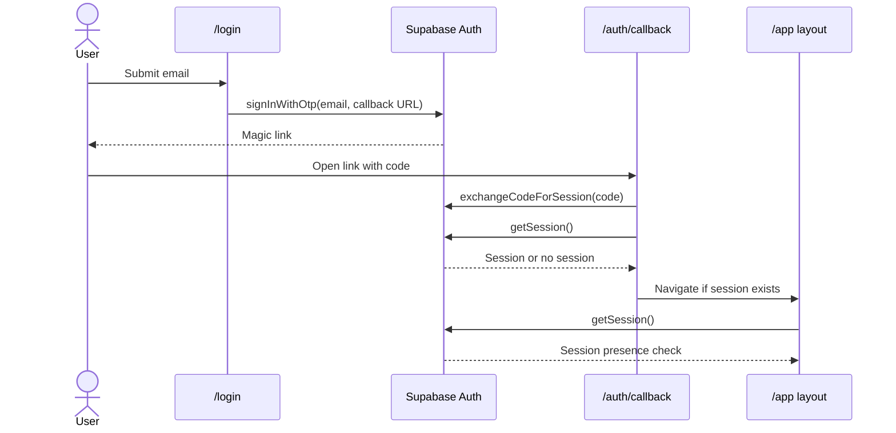

# TradeHub API and Integration Current State

Audit date: 2026-10-12  
Scope: repository inspection for Phase A. This document records the code in this checkout; it does not assert production configuration or database state.

## Executive Summary

The checked-in app is not yet backed by resource APIs. The main business screens are seeded from static exports in `src/lib/demo-data.ts`; CRUD-style changes are persisted in the current browser's `localStorage` by `usePersistentList`. Supabase is used for browser-side magic-link authentication and session checks only. The sole TanStack server function is an unauthenticated AI tagline check. No API route directory, server-side session/tenant guard, Supabase data query, webhook, or payment-provider integration was found.

The repository instructions describe this same state: no backend and static demo data. No `docs/AUDIT.md` was present. The supplied prompt's claims about production tenant tables, RLS, and `app_metadata.tenant_id` could not be verified from this checkout.

## A1. Authentication Flow

### Methods

| Method | Implementation | Call site | Behavior |
|---|---|---|---|
| `signInWithMagicLink(email)` | [`src/lib/auth.ts`](../../src/lib/auth.ts#L3) | [`src/routes/login.tsx`](../../src/routes/login.tsx#L27) | Trims and requires nonempty email; invokes Supabase `auth.signInWithOtp` with user creation enabled and callback URL `/auth/callback`. The form uses browser `type=email`; no Zod validation. |
| Callback/code exchange | Supabase client call in [`src/routes/auth.callback.tsx`](../../src/routes/auth.callback.tsx#L15) | `/auth/callback` | Exchanges query `code` for a session, then calls `auth.getSession`; sends a session to `/app`, otherwise back to `/login`. |
| `getSession()` | [`src/lib/auth.ts`](../../src/lib/auth.ts#L33) | No direct caller found. The layout and callback call Supabase `auth.getSession` directly. | Returns Supabase session data; client-side only. |
| `getUser()` | [`src/lib/auth.ts`](../../src/lib/auth.ts#L43) | No caller found. | Returns Supabase user from `auth.getUser`; client-side only. |
| `signOut()` | [`src/lib/auth.ts`](../../src/lib/auth.ts#L25) | No caller found. | Calls Supabase `auth.signOut`; no current UI path invokes it. |
| Session gate | [`src/routes/app.tsx`](../../src/routes/app.tsx#L116) | `/app` layout wraps app routes | Browser effect checks for a session; missing/error redirects to `/login`. It does not verify a tenant claim or protect API/data access on a server. |

The client is configured with `VITE_SUPABASE_URL` and `VITE_SUPABASE_ANON_KEY` in [`src/lib/supabase/client.ts`](../../src/lib/supabase/client.ts). Session persistence, refresh, and URL detection are enabled in the Supabase JS client. No server-side auth helper or service/admin client exists in `src/lib/supabase`.

## A2. Data Operations Inventory

“Local” below means client-side state initialized from demo exports and serialized to browser localStorage, not server persistence. `CrudPage` exposes create/update/delete callbacks and basic HTML required fields; it does not call a backend or apply a shared Zod schema.

| Operation | File:Line | Backend | Auth required | Input | Output / persistence |
|---|---|---|---|---|---|
| Orders: list and read detail | [`src/routes/app.orders.index.tsx`](../../src/routes/app.orders.index.tsx#L21), [`src/routes/app.orders.$id.tsx`](../../src/routes/app.orders.$id.tsx#L30) | None | `/app` session gate only | Demo `orders`; optional local modifications | Browser collection, seeded from demo exports |
| Orders: generic create/update/delete | [`src/routes/app.orders.index.tsx`](../../src/routes/app.orders.index.tsx#L25) | None | `/app` session gate only | Fields rendered by `CrudPage` | `tradehub:orders:v1` localStorage |
| Orders: advance order stage | [`src/routes/app.orders.$id.tsx`](../../src/routes/app.orders.$id.tsx#L62) | None | `/app` session gate only | Next allowed status; generated timeline update | Updates `tradehub:orders:v1` |
| Orders: shipment update and proof photos | [`src/components/ShipmentTracker.tsx`](../../src/components/ShipmentTracker.tsx#L65), [`src/components/ShipmentTracker.tsx`](../../src/components/ShipmentTracker.tsx#L149) | None; photos are compressed in browser | `/app` session gate only | Status, date, carrier, tracking number, note, up to five image files | Appends to order tracking updates; image data URLs stored in localStorage |
| Sourcing: list and read detail | [`src/routes/app.sourcing.index.tsx`](../../src/routes/app.sourcing.index.tsx#L29), [`src/routes/app.sourcing.$id.tsx`](../../src/routes/app.sourcing.$id.tsx#L13) | None | `/app` session gate only | Demo `sourcingRequests`; quote data is static | Browser collection plus static quote exports |
| Sourcing: generic create/update/delete | [`src/routes/app.sourcing.index.tsx`](../../src/routes/app.sourcing.index.tsx#L32) | None | `/app` session gate only | `CrudPage` fields, including code/client/product/stage | `tradehub:sourcing-requests:v1` localStorage |
| Sourcing: select quote / change stage | [`src/routes/app.sourcing.$id.tsx`](../../src/routes/app.sourcing.$id.tsx#L36), [`src/routes/app.sourcing.$id.tsx`](../../src/routes/app.sourcing.$id.tsx#L147) | None | `/app` session gate only | Selected quote or stage action | Updates `tradehub:sourcing-requests:v1` |
| Clients: list/read/create/update/delete | [`src/routes/app.clients.tsx`](../../src/routes/app.clients.tsx#L87), [`src/routes/app.clients.tsx`](../../src/routes/app.clients.tsx#L139) | None | `/app` session gate only | Client form validated by route-local Zod schema | `tradehub:clients:v1` localStorage |
| Payments: list/read and totals | [`src/routes/app.payments.index.tsx`](../../src/routes/app.payments.index.tsx#L22), [`src/routes/app.payments.ledger.tsx`](../../src/routes/app.payments.ledger.tsx#L20) | None | `/app` session gate only | Demo payments plus local collection; supplier ledger calculations | Browser collection; opening balances and supplier names are static |
| Payments: create | [`src/routes/app.payments.new.tsx`](../../src/routes/app.payments.new.tsx#L8), [`src/components/payments/PaymentForm.tsx`](../../src/components/payments/PaymentForm.tsx#L199) | None | `/app` session gate only | Payment details, optional lines/proof images; manual checks for amount/date/counterparty | Adds to `tradehub:payments:v1`, then navigates to local detail page |
| Payments: edit/delete | [`src/routes/app.payments.$id.tsx`](../../src/routes/app.payments.$id.tsx#L14), [`src/routes/app.payments.$id.tsx`](../../src/routes/app.payments.$id.tsx#L36) | None | `/app` session gate only | Payment form; delete confirmation | Updates/removes from `tradehub:payments:v1` |
| Payments: recurring templates | [`src/routes/app.payments.recurring.tsx`](../../src/routes/app.payments.recurring.tsx#L51) | None | `/app` session gate only | Native form fields for schedule, recipient, amount, currency, status | `tradehub:recurring-payments:v1` localStorage |
| Invoices/documents: list and read | [`src/routes/app.invoices.tsx`](../../src/routes/app.invoices.tsx#L166) | None | `/app` session gate only | Demo invoices and local records | Browser collection initialized from static documents |
| Invoices/documents: create and mark paid | [`src/routes/app.invoices.tsx`](../../src/routes/app.invoices.tsx#L191), [`src/routes/app.invoices.tsx`](../../src/routes/app.invoices.tsx#L230) | None | `/app` session gate only | Selected existing demo order, document kind, optional due date | Creates local record / updates status in `tradehub:invoices:v1`; generates/downloads PDF in browser. No delete action found. |
| Logistics partners: CRUD | [`src/routes/app.logistics.tsx`](../../src/routes/app.logistics.tsx#L14) | None | `/app` session gate only | `CrudPage` partner fields | `tradehub:logistics:v1` localStorage |
| Logistics shipments: read/update | [`src/components/ShipmentTracker.tsx`](../../src/components/ShipmentTracker.tsx#L65), [`src/components/ShipmentTracker.tsx`](../../src/components/ShipmentTracker.tsx#L149) | None | `/app` session gate only | Reads orders; submits shipment metadata and photos | Writes order updates to `tradehub:orders:v1`; no shipment-specific API/entity |
| Agents, suppliers, inbox: CRUD | [`src/routes/app.agents.tsx`](../../src/routes/app.agents.tsx#L10), [`src/routes/app.suppliers.tsx`](../../src/routes/app.suppliers.tsx#L10), [`src/routes/app.inbox.tsx`](../../src/routes/app.inbox.tsx#L10) | None | `/app` session gate only | Generic form fields | `tradehub:agents:v1`, `tradehub:suppliers:v1`, `tradehub:conversations:v1` localStorage |
| FX rates and user preferences | [`src/routes/app.fx.tsx`](../../src/routes/app.fx.tsx#L19), [`src/routes/app.settings.tsx`](../../src/routes/app.settings.tsx#L40) | None | `/app` session gate only | FX form and preferences form | `tradehub:fx-rates:v1` and `tradehub:preferences:v1` localStorage |

### CRUD and persistence notes

- `usePersistentList` reads/writes `tradehub:<collection>:v1`, assigns browser-generated UUIDs, and broadcasts storage/custom events. It seeds from provided demo arrays when no saved value exists: [`src/lib/use-persistent-list.ts`](../../src/lib/use-persistent-list.ts#L13).
- Data is per browser profile/device and is not shared between users, sessions, or deployments. Clearing site storage removes local changes.
- Dashboard KPIs, reporting, market, FX chart series, quote rankings, payment opening balances, and several lookup choices are static exports in `src/lib/demo-data.ts` or route constants.
- The client portal resolves the path token against demo client IDs/names and falls back to `clients[0]` for an unknown token; it reads orders from the local collection and payments from static demo data. It has no token lookup or client-scoped server authorization: [`src/routes/portal.$token.tsx`](../../src/routes/portal.$token.tsx#L19).

## A3. Form Submissions

| Form / submission | File | Validated? | Saves to | Persists? |
|---|---|---|---|---|
| Magic-link sign-in | [`src/routes/login.tsx`](../../src/routes/login.tsx#L21) | Email input type plus nonempty trim check; no Zod | Supabase Auth | Supabase-managed session; magic-link request is external |
| Client create/edit | [`src/routes/app.clients.tsx`](../../src/routes/app.clients.tsx#L139) | Yes, route-local Zod + React Hook Form | `usePersistentList` | Browser localStorage only |
| Generic list create/edit (orders, sourcing, agents, suppliers, logistics partners, inbox) | [`src/components/CrudPage.tsx`](../../src/components/CrudPage.tsx#L112) | Browser required attributes; number conversion; no Zod/server validation | `usePersistentList` callback | Browser localStorage only |
| Payment create/edit | [`src/components/payments/PaymentForm.tsx`](../../src/components/payments/PaymentForm.tsx#L199) | Manual checks for positive amount/date and inbound counterparty; client-side file checks/compression; no Zod | Payment collection callback | Browser localStorage only; proof images are data URLs |
| Invoice/document create | [`src/routes/app.invoices.tsx`](../../src/routes/app.invoices.tsx#L191) | Requires a resolvable selected order; other values are selected in the UI | Invoice collection; browser PDF generation/download | Browser localStorage + local file download only |
| Mark invoice paid | [`src/routes/app.invoices.tsx`](../../src/routes/app.invoices.tsx#L230) | No additional validation | Invoice collection | Browser localStorage only |
| Recurring payment template create/edit | [`src/routes/app.payments.recurring.tsx`](../../src/routes/app.payments.recurring.tsx#L72) | Native required/min constraints and direct casts; no Zod | `localStorage` directly | Browser localStorage only |
| FX rate save/reset | [`src/routes/app.fx.tsx`](../../src/routes/app.fx.tsx#L19) | Client-side inputs; no backend validation | `localStorage` directly | Browser localStorage only |
| Settings/preferences save/reset | [`src/routes/app.settings.tsx`](../../src/routes/app.settings.tsx#L59) | Client-side controls; no backend validation | `localStorage` directly | Browser localStorage only |
| Shipment tracking update | [`src/components/ShipmentTracker.tsx`](../../src/components/ShipmentTracker.tsx#L149) | Requires selected order; image type/count checked in browser; no Zod | Updates order collection | Browser localStorage only |
| Tagline check | [`src/components/TaglineChecker.tsx`](../../src/components/TaglineChecker.tsx#L19) | Server function validates `canonical` and `copy` with Zod (not `.strict()`) | Lovable AI gateway through server function | No business record persistence |

Other forms use `PaymentForm` or `CrudPage`; no sourcing-specific intake route or form file (`app.sourcing.new.tsx`) exists in this checkout.

## A4. Integration Points

| Service | Observed use | Credentials / data flow | Status |
|---|---|---|---|
| Supabase Auth | Magic-link request, code exchange, session check; browser SDK only | `VITE_SUPABASE_URL`, `VITE_SUPABASE_ANON_KEY`; email and auth code/session | Live code path when configured. No Supabase table query, storage upload, edge-function invocation, admin client, RLS query, or webhook found. |
| Lovable AI gateway | Tagline consistency checker | `LOVABLE_API_KEY` server environment variable; sends canonical tagline and submitted copy to `https://ai.gateway.lovable.dev/v1` | Called by `TaglineChecker` through the only `createServerFn` found. Function validates input but has no session/tenant authorization. |
| DeepSeek API | Product image vision service | `DEEPSEEK_API_KEY`, optional `DEEPSEEK_API_URL`; sends image URL in a chat-completion request | `VisionService` supports API call and mock fallback if key absent; source search found tests but no app call site. Treat as implemented library code, not currently wired product integration. |
| WhatsApp | Opens `wa.me` share URL from shipment/partner workflow | Message passed as encoded URL text; no authenticated API or delivery receipt | User-initiated link-out only. |
| Google Fonts | Font stylesheet/preconnect in root document | Public font request | Presentation dependency, not business data integration. |
| Payments / messaging / webhooks | No provider client or inbound endpoint found | None found | No M-Pesa, bank, Alipay, WeChat Pay, email delivery, or webhook integration in the inspected application code. Payment references are manually entered/parsed locally. |

## A5. Missing Backend Surface

Priorities are relative to the product workflow, not estimates of deployment readiness. Complexity assumes the current stack and the need for authenticated tenant-scoped persistence.

| Operation / surface needed | Needed by | Priority | Complexity |
|---|---|---:|---:|
| Server-side session verification and tenant context (`requireSession` equivalent) | Every protected API and tenant-owned record | P0 | M |
| Persistent clients: create/list/detail/update/delete, tenant-scoped | Client management, sourcing and orders | P0 | M |
| Persistent sourcing requests: create/list/detail/update/soft-delete, code generation, client linkage | Intake and sourcing pipeline | P0 | M-L |
| Order records and lifecycle/status transitions, including FX lock and audit history | Orders, dashboard, shipment tracking | P1 | L |
| Payments and payment lines/proof storage; reconciliation/provider integration as separately approved | Payments, supplier ledger, client portal | P1 | L |
| Invoices/documents and paid-state updates | Invoicing and client records | P1 | M-L |
| Shipment updates and secure photo upload/storage | Logistics tracker and client portal | P1 | M-L |
| Tenant-owned suppliers, agents, logistics partners, conversations/inbox | Partner and communication screens | P1 | L |
| Recurring payment schedules, FX settings, and user preferences | Payments, FX, settings | P2 | M |
| Client portal token issuance, lookup, expiry/revocation, and scoped reads (remove demo fallback) | `portal.$token` | P1 | M-L |
| Health endpoint, API error envelope, pagination/filter schemas, idempotency strategy | Operations and clients of resource APIs | P2 | M |
| Schema/database alignment, migrations, tenant foreign keys/indexes, authorization policy verification | All persistent operations | P0 | L |

### Current schema boundary

[`prisma/schema.prisma`](../../prisma/schema.prisma) declares six PostgreSQL models: `ProductKnowledge`, `SupplierScore`, `LogisticsScore`, `DraftQuote`, `MessageQueue`, and `RfqBatch`. Each includes `tenantId`, but the file declares no models for the primary app entities (tenants, user profiles, clients, sourcing requests, orders, payments, invoices, suppliers, agents, or shipments), no Prisma relations, and no RLS policies. Prisma model presence alone does not establish deployed tables or tenant isolation. No migration files or Supabase policy definitions were found in the inspected workspace.

## Audit Boundaries and Caveats

- This is a source checkout audit only. No production URL, Supabase dashboard, Cloudflare environment, database, or deployed RLS policies were queried.
- `src/server.ts` adapts the TanStack Start handler for deployment; it does not itself define resource API endpoints.
- `src/services/intelligence` includes domain/service logic and unit tests, but only the tagline checker has a discovered app caller. Do not assume every intelligence module is exposed to users or persists data.
- Package scripts include `build`, `typecheck`, and `lint`; there is no `test` script. Tests in the repository are not evidence of endpoint/integration tests.
- No code, schema, or test changes are part of this Phase A report.